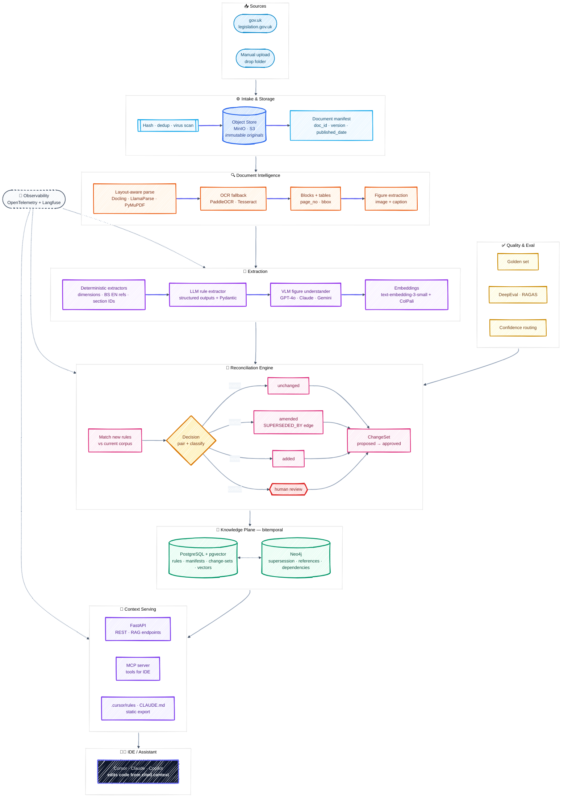

# UK Regs Pipeline

> A **versioned, cited, GraphRAG context-intelligence pipeline** for UK Building Regulations.
> Turns regulation PDFs (text + diagrams) into a single, queryable "current truth" that an
> IDE assistant (Cursor / Claude / Copilot via MCP) can use to update code — with every claim
> **cited to a source page**.

---

## Why this exists

UK building regulations are updated periodically (new Approved Documents, amended standards).
Each release is a dense PDF of rules + diagrams. Engineering teams need to:

1. **Remember** every version of every rule (nothing is lost).
2. **Update** the working context when a new PDF lands (what changed? what's superseded?).
3. **Consume** that context inside their tools (IDE assistant) so code/config can be regenerated
   against the latest rules — **with citations**, because compliance is critical.

This pipeline automates all three.

---

## Architecture (10-second version)

```
PDF → Intake → Document Intelligence → Deterministic Facts → LLM Rule Extraction
    → Figure Understanding (VLM) → Embeddings → Reconciliation Engine
    → Knowledge Graph (Neo4j) + Postgres/pgvector → Context Serving API + MCP Server → IDE
```

### System architecture diagram

> Rendered with a modern **hand-drawn (sketch)** aesthetic. If your platform's
> Mermaid is older and doesn't support `look: handDrawn`, it falls back gracefully
> to a clean flat theme.



| Principle | How |
|---|---|
| **Provenance** | Every rule stores `doc_id`, `version`, `page`, `bbox`, `raw_text`. No citation = no rule. |
| **Deterministic-first** | Regex/grammar extract dimensions, standards refs, section IDs *before* any LLM call. |
| **Bitemporal memory** | `valid_from`/`valid_to` + supersession edges. Old rules are never deleted, only superseded. |
| **Human-in-the-loop** | Change-sets are `proposed` until reviewed/approved; nothing goes live automatically by default. |
| **Graceful degradation** | Runs offline (deterministic-only) if no LLM/embedder is configured. |

---

## Monorepo layout

```
uk-regs-pipeline/
├─ packages/
│  ├─ core/           # types, config, enums, errors, ID helpers (pydantic-settings)
│  ├─ extraction/     # PDF parsing, deterministic extractors, LLM rule extractor, VLM figures
│  ├─ knowledge/      # object store, relational + graph repos, embeddings, schema.sql
│  └─ reconciliation/ # matchers + supersession engine (the "update memory" heart)
├─ pipelines/
│  └─ ingest/         # orchestrator + CLI (`uk-regs-ingest`)
├─ apps/              # (planned) FastAPI + MCP server
├─ infra/
│  ├─ compose/        # docker-compose: Postgres+pgvector, Neo4j, MinIO
│  ├─ docker/         # (Dockerfiles)
│  └─ terraform/      # (infra-as-code)
├─ tests/
├─ data/              # sample PDFs (gitignored)
├─ pyproject.toml     # uv workspace root
├─ Makefile
└─ .env.example
```

---

## Quick start

### Prerequisites
- **Python 3.12+**
- **[uv](https://docs.astral.sh/uv/)** (fast Python package manager)
- **Docker** (for Postgres, Neo4j, MinIO)
- *(optional)* **GNU Make** — or run the commands inside the `Makefile` manually.

### 1. Install
```bash
make install          # uv sync — installs all workspace packages in editable mode
cp .env.example .env  # then edit .env (set OPENAI_API_KEY to use the LLM)
```

### 2. Start the data plane
```bash
make up        # Postgres+pgvector (5432), Neo4j (7474/7687), MinIO (9000/9001)
make init-db   # apply schema.sql (idempotent)
```

### 3. Ingest a PDF
```bash
# Full pipeline (needs OPENAI_API_KEY):
make ingest PDF=path/to/adb.pdf TITLE="Approved Document B" VER="2026-ed1"

# Offline / deterministic-only (no API key, no network):
make ingest-offline PDF=path/to/adb.pdf TITLE="Approved Document B" VER="2026-ed1"
```

The CLI prints a rich summary: pages parsed, blocks, figures, rules extracted,
reconciliation decisions (`added`/`amended`/`superseded`/`unchanged`),
how many need review, and the `change_set_id`.

### 4. Direct CLI usage
```bash
uv run uk-regs-ingest --help
uv run uk-regs-ingest ingest data/sample.pdf --title "Approved Document B" --version 2026-ed1 --skip-llm
uv run uk-regs-ingest batch data/pdfs/ --version 2026-ed1 --skip-llm
```

---

## How "memory + update" works

Each extracted rule is a **typed Pydantic object** with provenance and bitemporal fields.
The **reconciliation engine** compares a new rule against the current corpus:

1. Embed the new rule; retrieve top-k candidate old rules in the same domain.
2. An LLM **pairs** them into `match | partial | novel | conflict` (with rationale + confidence).
3. Outcomes:
   - `match` → unchanged
   - `partial` → **amended**: create a `SUPERSEDED_BY` edge, close the old `valid_to`
   - `novel` → added
   - `conflict` → flagged for human review
4. The result is persisted as a **ChangeSet** (`proposed` status by default).
5. After review/approval (`--apply`), the new rules become `active` and form the new "current truth".

Old versions are **never deleted** — they remain queryable for audit history.

---

## Configuration

All config is 12-factor via `.env` (see `.env.example`), parsed by
`uk_regs_core.config.Settings` (pydantic-settings). Key knobs:

| Var | Default | Purpose |
|---|---|---|
| `OPENAI_API_KEY` | — | Enables LLM extraction + figure understanding |
| `LLM_PROVIDER` | `openai` | `openai` / `anthropic` / `bedrock` / `vllm` |
| `EMBEDDING_MODEL` | `text-embedding-3-small` | 1536-dim OpenAI embeddings |
| `CONFIDENCE_THRESHOLD` | `0.85` | Below this → route to human review |
| `RECONCILIATION_TOP_K` | `5` | Candidates per new rule during matching |

---

## Development

```bash
make fmt      # ruff format + autofix
make lint     # ruff check
make test     # pytest
make check    # lint + test
make logs     # tail data-plane logs
make reset    # ⚠ stop services and DELETE all volumes
```

---

## Roadmap

- [x] **Phase 1** — Vertical slice: ingest → parse → extract → persist → CLI
- [x] **Phase 2** — Bitemporal memory + reconciliation engine
- [ ] **Phase 3** — FastAPI context-serving API + **MCP server** (Cursor/Claude integration)
- [ ] **Phase 4** — Evals (golden set, DeepEval/RAGAS), review UI, auth, observability
- [ ] **Phase 5** — Scheduling/source monitoring, hybrid search, dashboards

---

## License & data

Source code: see `LICENSE`. UK regulation PDFs remain Crown copyright / OGL where applicable;
**do not commit** copyrighted PDFs to this repo — place them under `data/` (gitignored).