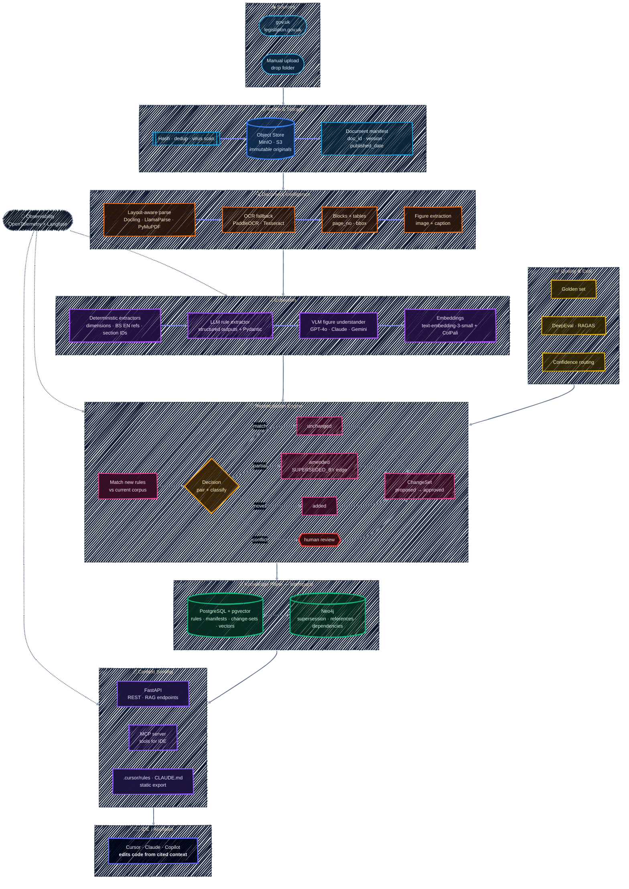

# UK Regs Pipeline

[](https://github.com/OmarJebbari/Uk-regs-pipeline/actions/workflows/ci.yml)
[](https://www.python.org/downloads/)
[](#development)
[](#evaluation--quality-gate-phase-4a)
[](#monorepo-layout)
[](LICENSE)
[](https://docs.astral.sh/ruff/)

> A **versioned, cited, GraphRAG context-intelligence pipeline** for UK Building Regulations.
> Turns regulation PDFs (text + diagrams) into a single, queryable "current truth" that an
> IDE assistant (Cursor / Claude / Copilot via MCP) can use to update code — with every claim
> **cited to a source page**.

---

## Why this exists

UK building regulations are updated periodically (new Approved Documents, amended standards).
Each release is a dense PDF of rules + diagrams. Engineering teams need to:

1. **Remember** every version of every rule (nothing is lost).
2. **Update** the working context when a new PDF lands (what changed? what's superseded?).
3. **Consume** that context inside their tools (IDE assistant) so code/config can be regenerated
   against the latest rules — **with citations**, because compliance is critical.

This pipeline automates all three.

---

## Features at a glance

| Capability | What it does |
|---|---|
| 📄 **Multi-modal PDF intake** | Layout-aware parsing (Docling / PyMuPDF), OCR fallback, figure/diagram extraction with captions |
| 🧠 **Hybrid extraction** | Deterministic regex/grammar extractors (dimensions, standards, section IDs) *before* LLM calls — precise and cheap |
| 🔄 **Bitemporal reconciliation** | New PDFs are diffed against the corpus: rules are `added` / `amended` / `superseded` / `unchanged` — nothing is ever lost |
| 🕸️ **GraphRAG knowledge plane** | Postgres + pgvector for vectors/facts, Neo4j for supersession & dependency edges |
| 🔍 **Hybrid search** | BM25 + vector retrieval fused via Reciprocal Rank Fusion — exact codes *and* semantic intent |
| 🤖 **IDE-native serving** | Live MCP server (Cursor/Claude), REST API, *and* committed static export (`.cursor/rules`, `CLAUDE.md`) |
| ✅ **100% eval gate** | Golden-set regression harness (extraction, reconciliation, retrieval, LLM-judge) blocks bad commits in CI |
| 👀 **Human-in-the-loop** | Dark-themed review dashboard for change-set approval/rejection before rules go live |
| 📡 **Source monitoring** | Auto-polls gov.uk / publishers for new PDFs and ingests them on a schedule |
| 🔐 **Production-ready** | API key auth, structlog JSON logging, OpenTelemetry tracing, Langfuse LLM observability — all opt-in, graceful dev-mode defaults |

## Tech stack

| Layer | Technology |
|---|---|
| **Language** | Python 3.12+, fully type-hinted (Pydantic v2) |
| **Package manager** | [uv](https://docs.astral.sh/uv/) workspace monorepo (8 packages) |
| **Extraction** | PyMuPDF, Docling, PaddleOCR/Tesseract, structured LLM outputs (OpenAI / Anthropic / Bedrock) |
| **Knowledge store** | PostgreSQL + pgvector, Neo4j, MinIO/S3 (immutable originals) |
| **Serving** | FastAPI (REST + Jinja2/HTMX dashboards), MCP server (stdio) |
| **Quality** | pytest (198 tests), ruff, golden-set evals (4 suites, 100% gate), DeepEval/RAGAS metrics |
| **Observability** | structlog, OpenTelemetry, Langfuse |
| **CI/CD** | GitHub Actions (lint + test + evals), pre-commit hooks, Dependabot |
| **Infra** | Docker Compose, Terraform (AWS ECS Fargate) |

---

## Architecture (10-second version)

```
PDF → Intake → Document Intelligence → Deterministic Facts → LLM Rule Extraction
    → Figure Understanding (VLM) → Embeddings → Reconciliation Engine
    → Knowledge Graph (Neo4j) + Postgres/pgvector → Context Serving API + MCP Server → IDE
```

### System architecture diagram

> 🌙 **Dark-mode native.** A deep-navy canvas with vibrant, glowing nodes and white text —
> designed to look striking on GitHub's dark theme (still perfectly readable in light mode).
> Rendered with a hand-drawn (sketch) outline for a modern whiteboard feel.



| Principle | How |
|---|---|
| **Provenance** | Every rule stores `doc_id`, `version`, `page`, `bbox`, `raw_text`. No citation = no rule. |
| **Deterministic-first** | Regex/grammar extract dimensions, standards refs, section IDs *before* any LLM call. |
| **Bitemporal memory** | `valid_from`/`valid_to` + supersession edges. Old rules are never deleted, only superseded. |
| **Human-in-the-loop** | Change-sets are `proposed` until reviewed/approved; nothing goes live automatically by default. |
| **Graceful degradation** | Runs offline (deterministic-only) if no LLM/embedder is configured. |

---

## Monorepo layout

```
uk-regs-pipeline/
├─ packages/
│  ├─ core/           # types, config, enums, errors, ID helpers (pydantic-settings)
│  ├─ extraction/     # PDF parsing, deterministic extractors, LLM rule extractor, VLM figures
│  ├─ knowledge/      # object store, relational + graph repos, embeddings, schema.sql
│  ├─ reconciliation/ # matchers + supersession engine (the "update memory" heart)
│  ├─ sourcing/       # source monitoring: fetchers, diff engine, scheduler, state store
│  ├─ export/         # static context renderer (.cursor/rules, CLAUDE.md, consolidated.md, JSON)
│  └─ evals/          # golden datasets, metrics, harnesses, `uk-regs-eval` CLI
├─ pipelines/
│  └─ ingest/         # orchestrator + CLI (`uk-regs-ingest`)
├─ apps/              # FastAPI context API (`uk-regs-api`) + MCP server (`uk-regs-mcp`)
├─ evals/
│  └─ golden/         # golden datasets: extraction · reconciliation · retrieval · llm_judge (YAML)
├─ infra/
│  ├─ compose/        # docker-compose: Postgres+pgvector, Neo4j, MinIO
│  ├─ docker/         # (Dockerfiles)
│  └─ terraform/      # (infra-as-code)
├─ tests/             # integration + evals golden-gate tests
├─ data/              # sample PDFs (gitignored)
├─ pyproject.toml     # uv workspace root
├─ Makefile
└─ .env.example
```

---

## Quick start

### Prerequisites
- **Python 3.12+**
- **[uv](https://docs.astral.sh/uv/)** (fast Python package manager)
- **Docker** (for Postgres, Neo4j, MinIO)
- *(optional)* **GNU Make** — or run the commands inside the `Makefile` manually.

### 1. Install
```bash
make install          # uv sync — installs all workspace packages in editable mode
cp .env.example .env  # then edit .env (set OPENAI_API_KEY to use the LLM)
```

### 2. Start the data plane
```bash
make up        # Postgres+pgvector (5432), Neo4j (7474/7687), MinIO (9000/9001)
make init-db   # apply schema.sql (idempotent)
```

### 3. Ingest a PDF
```bash
# Full pipeline (needs OPENAI_API_KEY):
make ingest PDF=path/to/adb.pdf TITLE="Approved Document B" VER="2026-ed1"

# Offline / deterministic-only (no API key, no network):
make ingest-offline PDF=path/to/adb.pdf TITLE="Approved Document B" VER="2026-ed1"
```

The CLI prints a rich summary: pages parsed, blocks, figures, rules extracted,
reconciliation decisions (`added`/`amended`/`superseded`/`unchanged`),
how many need review, and the `change_set_id`.

### 4. Direct CLI usage
```bash
uv run uk-regs-ingest --help
uv run uk-regs-ingest ingest data/sample.pdf --title "Approved Document B" --version 2026-ed1 --skip-llm
uv run uk-regs-ingest batch data/pdfs/ --version 2026-ed1 --skip-llm
```

### 5. Serve context to your IDE
```bash
uv run uk-regs-api          # FastAPI on http://localhost:8000 (REST + /docs)
uv run uk-regs-mcp          # MCP server over stdio for Cursor/Claude Desktop
```

### 6. Review proposed change-sets (human-in-the-loop UI)
```bash
make api-mock    # start the API (mock backend, no Docker needed)
make review      # open the Review UI at http://localhost:8000/ui/
```
The **ChangeSet Review UI** is a dark-themed Jinja2 + HTMX dashboard built into
the API. It lists every reconciliation change-set with live status counts, lets
you drill into a side-by-side diff of each delta (matched vs new rule), and apply
a review decision (`applied` / `rejected` / `rolled_back`) inline — the page
re-renders with a confirmation flash. Available both via the UI and the JSON API:
```bash
# JSON API equivalent
curl -X POST http://localhost:8000/changes/cs-001/review \
  -d "decision=applied&reviewer=alice&notes=lgtm"
```

MCP wiring for Cursor (`~/.cursor/mcp.json`):
```json
{
  "mcpServers": {
    "uk-regs": {
      "command": "uv",
      "args": ["--directory", "<path>/uk-regs-pipeline", "run", "uk-regs-mcp"]
    }
  }
}
```
Then ask Cursor/Claude: *"check the design intent for a 3-storey residential escape route"* — it calls `check_design_intent`, returns cited rules, and generates code that references `rule_id` + source page.

### 7. Run the evals (golden gate)
```bash
make eval          # all suites vs live backend (Postgres if up, else mock)
make eval-offline  # no DB needed — skips retrieval, writes reports/eval.md
make eval-list     # just list the golden cases
```
The golden gate enforces **100% accuracy** across four suites (extraction,
reconciliation, retrieval, llm_judge). Run it before every PR — it's wired into `make check`.

### 8. Auth & observability (production hardening)

The API ships with three opt-in production layers — all degrade gracefully to
zero-config dev mode:

**API key auth** — set `API_KEY` in `.env` to gate mutating routes
(`POST /changes/.../review`). Read endpoints (`GET`) and health probes stay open.
When `API_KEY` is unset, the API runs in open dev mode.

```bash
make api-protected   # start the API with API_KEY gating enabled
# Clients must send:  X-API-Key: <your-key>
```

**Structured logging** — [structlog](https://www.structlog.org/) emits JSON in
prod (`LOG_FORMAT=json`) or pretty colored console in dev. Every request is
auto-tagged with `request_id`, `method`, `path`, `status_code`, `latency_ms`.
A `X-Request-ID` header is echoed back for distributed tracing.

```bash
curl -H "X-Request-ID: trace-123" http://localhost:8000/healthz
# response header: x-request-id: trace-123
```

**OpenTelemetry tracing** — set `OTEL_EXPORTER_OTLP_ENDPOINT` to ship spans
to a collector (Jaeger, Tempo, Grafana). FastAPI auto-instrumentation is
included. Leave unset to disable.

**Langfuse LLM observability** — set `LANGFUSE_PUBLIC_KEY` + `LANGFUSE_SECRET_KEY`
to trace every LLM call (rule extraction, figure understanding) with full
prompt/response payloads. Leave unset to disable.

```bash
make api-otel   # start the API with OTel traces → your collector
```

---

## Source monitoring & auto-ingestion (Phase 5-1)

The pipeline ships a **source monitor** that watches authoritative publishers
(e.g. gov.uk planning portal) and automatically ingests new/changed PDFs the
moment they appear — so the "current truth" stays in sync without manual
intervention.

### How it works

1. **Sources are declared** in `sources.yaml` (publisher → URL/path → poll interval).
2. A **fetcher** (`http` / `local` / `mock`) lists the documents a source publishes.
3. The **diff engine** compares against seen-state (`sha256` + `version` + `size`)
   and decides: `ingest` (new), `update` (changed), or `skip` (unchanged).
4. New/changed PDFs are streamed into the **existing ingest pipeline** →
   reconciliation → change-set. The state store is updated.
5. Polling is throttled per-source via `poll_interval_minutes` to avoid hammering publishers.

### Run it

```bash
# One-shot poll cycle (cron / GitHub Actions):
make source-once

# Long-running scheduler (polls every 60 min):
make source-watch

# Trigger a poll via the API:
make source-poll   # POST /sources/poll?force=true
```

### Declare a new source

Edit `sources.yaml`:

```yaml
sources:
  - source_id: gov-uk-adb
    title: "Approved Document B (Fire Safety)"
    publisher: gov.uk
    fetcher: http
    url: "https://assets.publishing.service.gov.uk/.../adb.pdf"
    poll_interval_minutes: 1440   # daily
    enabled: true
```

Three fetcher kinds are supported:
- **`http`** — polls a URL (manifest page or direct PDF link).
- **`local`** — scans a directory for new PDFs (drop-folder / network share).
- **`mock`** — in-memory, for tests.

### API surface

| Endpoint | Method | Purpose |
|---|---|---|
| `/sources` | GET | List all watched sources + seen-document counts + last-poll time |
| `/sources/poll` | POST | Trigger a poll cycle (optional `?force=true` to ignore intervals) |

---

## Hybrid search (BM25 + Vector) — Phase 5-2

The context-serving API supports **three retrieval modes** so you get the
best of both worlds: dense semantic similarity for paraphrased intent, and
sparse keyword matching for exact codes, standards numbers, and dimensions.

| Mode | Legs used | Best for |
|---|---|---|
| `hybrid` *(default)* | BM25 **+** pgvector, fused via **Reciprocal Rank Fusion** | General queries mixing concepts + identifiers |
| `semantic` | pgvector only (cosine similarity) | Paraphrased / conceptual queries ("how wide does an escape route need to be?") |
| `keyword` | BM25 only (`tsvector` + `ts_rank`) | Exact lookups ("FD30", "BS 476-22", "5000 mm²") |

### Why hybrid?

Pure semantic embeddings are great at *intent* but surprisingly bad at
matching exact codes — `FD30` and `FD60` embed nearly identically, and
"BS 476-22" is opaque to a language model. Conversely, pure BM25 misses
synonyms and paraphrases. **RRF** combines both rankings without needing
calibrated scores:

```
RRF_score(doc) = Σ  1 / (k + rank_i(doc))
```

where `k` is a smoothing constant (default `60`, per Cormack et al. 2009)
and `rank_i` is the document's 1-based rank in each leg. Documents that
appear in **both** legs get a higher fused score than single-leg hits.

### API

```bash
# Default (hybrid):
curl "http://localhost:8000/search?q=fire+door+FD30&top_k=5"

# Keyword-only (fastest, best for exact codes):
curl "http://localhost:8000/search?q=BS+476-22&mode=keyword"

# Semantic-only (pure vector):
curl "http://localhost:8000/search?q=how+wide+escape+route&mode=semantic"
```

Response includes the `mode` used and per-hit scores:

```json
{
  "query": "fire door FD30",
  "mode": "hybrid",
  "count": 3,
  "hits": [
    {"rule_id": "rule-fire-001", "score": 0.032, "text": "...", "citation": {...}}
  ]
}
```

### Tuning

| Env var | Default | Effect |
|---|---|---|
| `SEARCH_RRF_K` | `60` | Higher → more weight to rank position. Lower → more democratic. |
| `SEARCH_CANDIDATE_K` | `50` | How many candidates each leg pulls *before* fusion. Must be ≥ `top_k`. |
| `SEARCH_MIN_SCORE` | `0.0` | Drops fused hits below this score (raises precision; `0.0` = keep all). |

### Graceful degradation

If the embedding service is unavailable (no `OPENAI_API_KEY`, embedder
down), `hybrid` mode automatically falls back to the keyword leg only —
the API never crashes because of a missing vector index.

---

## Ops Dashboard (Phase 5-3)

A live **operations dashboard** built into the API that gives a single-screen
overview of pipeline health: how many rules are active, how they break down by
status and category, how many documents/versions are stored, the review-queue
backlog, and source-monitoring coverage.

### Access it

```bash
make api-mock    # start the API (mock backend, no Docker needed)
make ops         # open the Ops Dashboard at http://localhost:8000/ops
```

The dashboard is a dark-themed Jinja2 page with stat tiles and breakdown
tables. A **Refresh** button (HTMX) polls `/ops/stats?partial=1` and swaps in
fresh counts without a full page reload — so you can keep it open on a ops
monitor.

### Endpoints

| Endpoint | Returns | Purpose |
|---|---|---|
| `/ops` | HTML | Full dashboard page (renders tiles + breakdowns) |
| `/ops/stats` | JSON | Machine-readable `PipelineStats` snapshot for monitoring/alerting |
| `/ops/stats?partial=1` | HTML fragment | HTMX partial (tile grid only, no `<html>` shell) |

### What it shows

| Tile | Source |
|---|---|
| **Active Rules** | rules with `status = active` |
| **Total Rules** | all rule rows (incl. superseded) |
| **Rules by Status** | `active` / `superseded` / `draft` counts |
| **Rules by Category** | fire-safety / structural / accessibility / etc. |
| **Documents / Versions** | document manifest + version counts |
| **Review Queue** | change-sets by status + pending-review count |
| **Sources** | monitored sources (total / enabled) |

The JSON endpoint (`/ops/stats`) returns the same data for external
monitoring — wire it into Grafana, Datadog, or a simple cron alert.

---

## Static context export — Phase 6-1

The pipeline renders the consolidated "current truth" into **IDE-native static
files** you can commit alongside your code. This is the offline counterpart to
the live API/MCP server: one command, zero runtime dependency, every rule
carries its citation.

### Why static export?

The MCP server and `/search` API give your IDE **live, cited** context. But
some workflows want a **committed artifact** — a checked-in snapshot of the
regulations that travels with the repo, works offline, diffs in PRs, and is
auditable. The export package produces exactly that.

### What it generates

| File | Format | Consumed by |
|---|---|---|
| `.cursor/rules/*.mdc` | Cursor rule files (one per category, YAML frontmatter + globs) | **Cursor IDE** |
| `.cursorrules` | Legacy flat-file (all rules) | Older Cursor setups |
| `CLAUDE.md` | Single-file context with usage instructions | **Claude Code / Claude Desktop** |
| `consolidated.md` | Human-readable markdown (all rules grouped by category, with citations) | Code review / documentation |
| `regulations.json` | Machine-readable full payload (rules + citations + parameters) | Custom tooling / round-trip re-render |

Every rendered rule includes:
- The rule text + normalized form
- Inline parameters (e.g. `min_width = 1100mm`)
- A **citation block**: `doc_id`, `version`, `page`, `url` — so the IDE can
  trace any generated code back to the source PDF page.

### Run it

```bash
# Render the full bundle from the running API → dist/export/
make export

# Dry-run (list what would be generated, no files written):
make export-dry

# Render from a previously-exported regulations.json (no API needed):
make export-json JSON=regulations.json

# Or use the CLI directly:
uv run uk-regs-export render --api http://localhost:8000 --out dist/export/
uv run uk-regs-export render --json regulations.json --out ./
```

### API surface (download endpoints)

The API also serves each artifact directly, so CI/CD or a Git hook can fetch
the latest snapshot:

| Endpoint | Returns |
|---|---|
| `GET /export` | JSON manifest of available artifacts |
| `GET /export/claude.md` | `CLAUDE.md` |
| `GET /export/consolidated.md` | Consolidated markdown |
| `GET /export/regulations.json` | Full JSON payload |
| `GET /export/cursor/{category}.mdc` | One Cursor rule file per category |
| `GET /export/cursorrules` | Legacy `.cursorrules` flat file |
| `GET /export/markdown` | Alias for `consolidated.md` (back-compat) |

### Architecture

The export package has **zero dependency on the API package** — the renderers
are pure functions (`render_all`, `render_cursor_mdc`, `render_claude_md`,
`render_consolidated_md`, `render_json`). The CLI fetches rules over HTTP (or
from a JSON file) and calls the pure renderers. This keeps the dependency
graph acyclic: `api → export`, never `export → api`.

---

## Deployment (Docker) — Phase 7

The entire stack — data plane **and** application — runs in Docker with a
single command. Three production-grade images are provided:

| Image | Dockerfile | Purpose |
|---|---|---|
| `uk-regs-api` | `infra/docker/Dockerfile.api` | FastAPI context API (port 8000) |
| `uk-regs-worker` | `infra/docker/Dockerfile.worker` | Ingest worker (one-shot, `docker compose run`) |
| `uk-regs-mcp` | `infra/docker/Dockerfile.mcp` | MCP server (stdio, for IDE integration) |

All three use a **multi-stage build** with `uv` and a non-root `ukregs` user
(uid 1001). A `.dockerignore` keeps build context lean and prevents secrets
from leaking into image layers.

### Run the full stack

```bash
# Build + start data plane + API together:
make compose-up-app

# → API now live at http://localhost:8000
```

This is the data-plane compose (`docker-compose.yml`) **plus** the app
overlay (`docker-compose.app.yml`). Secrets are passed through from the host
env: set `OPENAI_API_KEY`, `API_KEY`, etc. in your shell or `.env` and they
flow into the containers.

### Ingest a PDF through the worker

```bash
# Drop the PDF in ./pdfs/, then:
make docker-ingest PDF=pdfs/adb.pdf TITLE="Approved Document B" VER="2026-ed1"
```

The worker runs as a one-shot container, mounts `./pdfs` read-only, and writes
into the shared data plane.

### Other targets

```bash
make compose-build-app      # build all three images without starting
make compose-logs-app       # tail API + worker logs
make compose-down-app       # stop the app layer (data volumes intact)
make docker-shell           # shell into the API container (debug)

# Build/push a single image to a registry:
make image-build SVC=api
make image-push  SVC=api REG=ghcr.io/your-org
```

### Production notes

- The API image runs as non-root, so bind to ports ≥ 1024 (port 8000 by default).
- Structured JSON logging is enabled in the container (`LOG_FORMAT=json`).
- For IDE integration with the MCP image, point your IDE at the running
  container, or run the MCP server locally with `UK_REGS_API_URL` pointing at
  the containerised API.

---

## How "memory + update" works

Each extracted rule is a **typed Pydantic object** with provenance and bitemporal fields.
The **reconciliation engine** compares a new rule against the current corpus:

1. Embed the new rule; retrieve top-k candidate old rules in the same domain.
2. An LLM **pairs** them into `match | partial | novel | conflict` (with rationale + confidence).
3. Outcomes:
   - `match` → unchanged
   - `partial` → **amended**: create a `SUPERSEDED_BY` edge, close the old `valid_to`
   - `novel` → added
   - `conflict` → flagged for human review
4. The result is persisted as a **ChangeSet** (`proposed` status by default).
5. After review/approval (`--apply`), the new rules become `active` and form the new "current truth".

Old versions are **never deleted** — they remain queryable for audit history.

---

## Evaluation & quality gate (Phase 4A)

Because this is compliance-critical, the pipeline ships a **golden-set regression harness**
that blocks a commit if accuracy drops below 100%.

### The four suites (`evals/golden/`)

| Suite | YAML | What it checks |
|---|---|---|
| **Extraction** | `extraction.yaml` | Deterministic extractors pull the right typed facts (dimensions, standards refs, section IDs) from raw PDF text — incl. unicode edge cases (`mm²`, smart quotes, en/em dashes). |
| **Reconciliation** | `reconciliation.yaml` | The engine pairs new vs old rules into the correct decision — `match` / `partial` (amended) / `novel` (added) / `conflict` (review) — driven by text-similarity + parameter-equality, not raw candidate scores. |
| **Retrieval** | `retrieval.yaml` | The context-serving layer returns the right cited rules for a design-intent query. |
| **LLM-judge** | `llm_judge.yaml` | Context *quality*, not just correctness — scores the served context on **faithfulness** (no hallucinated measurements), **relevance** to the query, and **citation precision** (every claim cites a real `rule_id`). Runs a real LLM-as-a-judge when `OPENAI_API_KEY` is set; otherwise a deterministic rubric fallback (token-overlap + citation containment) so the gate still holds in CI. |

### CLI

```bash
uv run uk-regs-eval run                                       # all suites, auto backend
uv run uk-regs-eval run --suite llm_judge                     # context-quality suite only
uv run uk-regs-eval run --no-retrieval --out reports/eval.md  # offline markdown report
uv run uk-regs-eval list                                      # list golden cases
```

`UK_REGS_BACKEND` selects the backend for both the API and the evals:
- **`auto`** *(default)* — uses Postgres if the services are up, otherwise falls back to an in-memory mock.
- **`mock`** — forces the in-memory mock (no Docker needed; great for CI).
- **`postgres`** — forces the live Postgres + Neo4j backend.

### CI gate

The evals are wired into the test suite (`tests/test_evals.py`), so `make check`
(lint + test) is a **hard 100% accuracy gate**. A regression in any golden case
fails the build before it reaches `main`.

The same gate runs automatically on every push and pull request via
**GitHub Actions** (`.github/workflows/ci.yml`). It uses `uv` with caching, runs
the full lint + test + evals suite against the in-memory mock backend (no Docker,
no API key required), and uploads the eval report as a build artifact. Check the
badge at the top of this README for the live status.

---

## Configuration

All config is 12-factor via `.env` (see `.env.example`), parsed by
`uk_regs_core.config.Settings` (pydantic-settings). Key knobs:

| Var | Default | Purpose |
|---|---|---|
| `OPENAI_API_KEY` | — | Enables LLM extraction + figure understanding |
| `LLM_PROVIDER` | `openai` | `openai` / `anthropic` / `bedrock` / `vllm` |
| `EMBEDDING_MODEL` | `text-embedding-3-small` | 1536-dim OpenAI embeddings |
| `CONFIDENCE_THRESHOLD` | `0.85` | Below this → route to human review |
| `RECONCILIATION_TOP_K` | `5` | Candidates per new rule during matching |
| `UK_REGS_BACKEND` | `auto` | Backend for API + evals: `auto` (Postgres if up, else mock) / `mock` / `postgres` |
| `API_KEY` | *(unset)* | If set, mutating routes require `X-API-Key` header. Unset = open dev mode. |
| `LOG_FORMAT` | `console` | `json` (prod) or `console` (dev, colored) via structlog |
| `OTEL_EXPORTER_OTLP_ENDPOINT` | *(unset)* | OTLP collector URL. Unset = tracing disabled. |
| `LANGFUSE_PUBLIC_KEY` | *(unset)* | Langfuse LLM tracing. Unset = disabled. |
| `SEARCH_RRF_K` | `60` | RRF smoothing constant for hybrid search. |
| `SEARCH_CANDIDATE_K` | `50` | Candidates per leg before fusion (≥ `top_k`). |
| `SEARCH_MIN_SCORE` | `0.0` | Minimum fused score to include a result. |

---

## Development

```bash
make fmt          # ruff format + autofix
make lint         # ruff check
make test         # pytest
make check        # lint + test (includes the evals golden gate)
make ci           # the EXACT gate GitHub Actions runs (lint + test + evals, mock backend)
make eval         # golden-set regression gate (100% accuracy)
make eval-offline # same, but no DB (skips retrieval suite)
make hooks        # install pre-commit hooks (ruff + pytest gate on every commit/push)
make logs         # tail data-plane logs
make reset        # ⚠ stop services and DELETE all volumes
```

### Pre-commit hooks (optional but recommended)

```bash
make hooks   # installs ruff format/check + pytest-on-push via pre-commit
```

After this, every `git commit` auto-formats + lints, and every `git push` runs
the full test suite locally — so a broken commit never reaches CI.

---

## Roadmap

- [x] **Phase 1** — Vertical slice: ingest → parse → extract → persist → CLI
- [x] **Phase 2** — Bitemporal memory + reconciliation engine
- [x] **Phase 3** — FastAPI context-serving API + **MCP server** (Cursor/Claude integration)
- [x] **Phase 4A** — **Evals harness + golden gate** (retrieval / reconciliation / extraction suites, deterministic metrics, `uk-regs-eval` CLI, 100% accuracy gate enforced in CI)
  - Unicode-normalising extractor (handles `mm²`, smart quotes, en/em dashes from PDFs)
  - Precision-calibrated reconciliation decisioning (text-similarity + parameter-equality driven, not raw candidate score)
- [ ] **Phase 4B** — Production hardening *(in progress)*
  - [x] **4B‑1 · CI/CD** ✅ — GitHub Actions quality gate (lint + test + evals, 100% accuracy gate), `uv` caching, pre-commit hooks, Dependabot, line-ending hygiene, `make ci` / `make hooks`
  - [x] **4B‑2 · LLM-as-a-judge** ✅ — Context-quality scoring (faithfulness, answer-relevance, citation precision) via the 4th golden suite (`llm_judge.yaml`); runs live with a real judge when `OPENAI_API_KEY` is set, falls back to a deterministic rubric so the gate still holds in CI
  - [x] **4B‑3a · Review UI** ✅ — Dark-themed ChangeSet review dashboard (Jinja2 + HTMX): live status counts, side-by-side delta diffs, inline apply/reject/rollback with HTMX partial re-render. New `make review` target opens it in the browser.
  - [x] **4B‑3b · Auth & observability** ✅ — API key gating on mutating routes, structlog structured logging (JSON/console), OpenTelemetry tracing (opt-in), Langfuse LLM tracing (opt-in), `/healthz` + `/readyz` probes, request-id propagation. All degrade gracefully when unset.
- [ ] **Phase 5** — Scheduling/source monitoring, hybrid search, dashboards
  - [x] **5‑1 · Source monitoring & auto-ingestion** ✅ — Pluggable source monitor
    (`sources.yaml`) with `http` / `local` / `mock` fetchers, a diff engine
    (sha256 + version + size), APScheduler loop (`--once` / `--watch`),
    `source_documents` state table, and `/sources` + `/sources/poll` API endpoints.
    New/changed PDFs flow straight into the existing ingest pipeline.
  - [x] **5‑2 · Hybrid search (BM25 + vector)** ✅ — Reciprocal Rank Fusion
    of a Postgres `tsvector` (BM25/ts_rank) leg and a pgvector (cosine)
    leg. Three modes via `/search?mode=hybrid|semantic|keyword`.
    Configurable `SEARCH_RRF_K`, `SEARCH_CANDIDATE_K`, `SEARCH_MIN_SCORE`.
    Graceful degradation when embeddings are unavailable.
  - [x] **5‑3 · Ops Dashboard** ✅ — Live pipeline-health dashboard at `/ops`
    (dark-themed Jinja2 + HTMX): active/total rules, rules-by-status, rules-by-category,
    document/version counts, review-queue backlog, source-monitoring coverage.
    JSON endpoint at `/ops/stats` for external monitoring (Grafana/Datadog).
    HTMX partial refresh (`/ops/stats?partial=1`) for no-reload polling.
    New `make ops` target opens it in the browser.
- [ ] **Phase 6** — IDE-native consumption (static export + agentic workflows)
  - [x] **6‑1 · Static context export** ✅ — Pure-function renderers that turn the
    consolidated "current truth" into committed, offline, IDE-native artifacts:
    Cursor `.mdc` rule files (per-category, YAML frontmatter + globs), `CLAUDE.md`
    (with usage instructions), `consolidated.md` (human-readable, citation-bearing),
    and `regulations.json` (machine-readable round-trip payload). `uk-regs-export`
    CLI (`--api` / `--json` / `--dry-run`), `/export/*` download endpoints, and
    `make export` / `export-dry` / `export-json` targets. Zero dependency on the
    API package (acyclic: `api → export`).
- [x] **Phase 7** — Containerised deployment ✅ — Multi-stage Docker images
  (`Dockerfile.api` / `.worker` / `.mcp`) with `uv`, non-root `ukregs` user,
  `.dockerignore`, `docker-compose.app.yml` overlay, and `make compose-up-app` /
  `docker-ingest` / `image-build` / `image-push` targets. Full stack runs with
  one command.
- [x] **Phase 14** — AWS Terraform stack ✅ — Production IaC for ECS Fargate:
  VPC (public/private + NAT), RDS Postgres+pgvector (Multi-AZ + PITR),
  S3 (versioned originals), ECR (per-image repos + lifecycle), Secrets Manager
  (DB creds / OpenAI key / API key), Route 53 + ACM (managed DNS + HTTPS),
  least-privilege IAM, CloudWatch logging. `dev` + `prod` tfvars,
  `make tf-init / tf-plan / tf-apply / tf-output` targets.

---

## License

> ⚠️ **Proprietary & Commercial.** This Software is **not** open-source.

Copyright © 2026 **Omar Jebbari**. All rights reserved.

This Software is the exclusive property of Omar Jebbari. It is licensed, not
sold. Use, copying, modification, distribution, or sublicensing of this
Software — in whole or in part — is **strictly prohibited** without a valid,
paid License obtained directly from Omar Jebbari.

Only individuals or entities who have **purchased or rented** a License may
use the Software, and only within the terms of that License (number of seats,
term, and scope). Unauthorized use is a violation of the Licensor's
intellectual property rights and may result in civil and criminal penalties.

For licensing inquiries, purchases, or to report unauthorized use, contact:
**Omar Jebbari** — https://github.com/OmarJebbari

The full terms are in [`LICENSE`](LICENSE).

> **Note on data:** UK regulation PDFs remain Crown copyright / OGL where
> applicable. **Do not commit** copyrighted PDFs to this repo — place them
