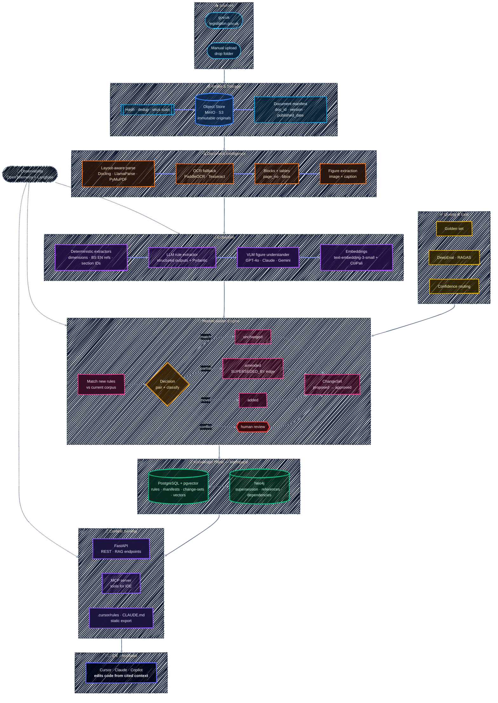

# UK Regs Pipeline

[](https://github.com/OmarJebbari/Uk-regs-pipeline/actions/workflows/ci.yml)
[](https://www.python.org/downloads/)
[](LICENSE)
[](#evaluation--quality-gate-phase-4a)

> A **versioned, cited, GraphRAG context-intelligence pipeline** for UK Building Regulations.
> Turns regulation PDFs (text + diagrams) into a single, queryable "current truth" that an
> IDE assistant (Cursor / Claude / Copilot via MCP) can use to update code — with every claim
> **cited to a source page**.

---

## Why this exists

UK building regulations are updated periodically (new Approved Documents, amended standards).
Each release is a dense PDF of rules + diagrams. Engineering teams need to:

1. **Remember** every version of every rule (nothing is lost).
2. **Update** the working context when a new PDF lands (what changed? what's superseded?).
3. **Consume** that context inside their tools (IDE assistant) so code/config can be regenerated
   against the latest rules — **with citations**, because compliance is critical.

This pipeline automates all three.

---

## Architecture (10-second version)

```
PDF → Intake → Document Intelligence → Deterministic Facts → LLM Rule Extraction
    → Figure Understanding (VLM) → Embeddings → Reconciliation Engine
    → Knowledge Graph (Neo4j) + Postgres/pgvector → Context Serving API + MCP Server → IDE
```

### System architecture diagram

> 🌙 **Dark-mode native.** A deep-navy canvas with vibrant, glowing nodes and white text —
> designed to look striking on GitHub's dark theme (still perfectly readable in light mode).
> Rendered with a hand-drawn (sketch) outline for a modern whiteboard feel.



| Principle | How |
|---|---|
| **Provenance** | Every rule stores `doc_id`, `version`, `page`, `bbox`, `raw_text`. No citation = no rule. |
| **Deterministic-first** | Regex/grammar extract dimensions, standards refs, section IDs *before* any LLM call. |
| **Bitemporal memory** | `valid_from`/`valid_to` + supersession edges. Old rules are never deleted, only superseded. |
| **Human-in-the-loop** | Change-sets are `proposed` until reviewed/approved; nothing goes live automatically by default. |
| **Graceful degradation** | Runs offline (deterministic-only) if no LLM/embedder is configured. |

---

## Monorepo layout

```
uk-regs-pipeline/
├─ packages/
│  ├─ core/           # types, config, enums, errors, ID helpers (pydantic-settings)
│  ├─ extraction/     # PDF parsing, deterministic extractors, LLM rule extractor, VLM figures
│  ├─ knowledge/      # object store, relational + graph repos, embeddings, schema.sql
│  ├─ reconciliation/ # matchers + supersession engine (the "update memory" heart)
│  └─ evals/          # golden datasets, metrics, harnesses, `uk-regs-eval` CLI
├─ pipelines/
│  └─ ingest/         # orchestrator + CLI (`uk-regs-ingest`)
├─ apps/              # FastAPI context API (`uk-regs-api`) + MCP server (`uk-regs-mcp`)
├─ evals/
│  └─ golden/         # golden datasets: extraction · reconciliation · retrieval · llm_judge (YAML)
├─ infra/
│  ├─ compose/        # docker-compose: Postgres+pgvector, Neo4j, MinIO
│  ├─ docker/         # (Dockerfiles)
│  └─ terraform/      # (infra-as-code)
├─ tests/             # integration + evals golden-gate tests
├─ data/              # sample PDFs (gitignored)
├─ pyproject.toml     # uv workspace root
├─ Makefile
└─ .env.example
```

---

## Quick start

### Prerequisites
- **Python 3.12+**
- **[uv](https://docs.astral.sh/uv/)** (fast Python package manager)
- **Docker** (for Postgres, Neo4j, MinIO)
- *(optional)* **GNU Make** — or run the commands inside the `Makefile` manually.

### 1. Install
```bash
make install          # uv sync — installs all workspace packages in editable mode
cp .env.example .env  # then edit .env (set OPENAI_API_KEY to use the LLM)
```

### 2. Start the data plane
```bash
make up        # Postgres+pgvector (5432), Neo4j (7474/7687), MinIO (9000/9001)
make init-db   # apply schema.sql (idempotent)
```

### 3. Ingest a PDF
```bash
# Full pipeline (needs OPENAI_API_KEY):
make ingest PDF=path/to/adb.pdf TITLE="Approved Document B" VER="2026-ed1"

# Offline / deterministic-only (no API key, no network):
make ingest-offline PDF=path/to/adb.pdf TITLE="Approved Document B" VER="2026-ed1"
```

The CLI prints a rich summary: pages parsed, blocks, figures, rules extracted,
reconciliation decisions (`added`/`amended`/`superseded`/`unchanged`),
how many need review, and the `change_set_id`.

### 4. Direct CLI usage
```bash
uv run uk-regs-ingest --help
uv run uk-regs-ingest ingest data/sample.pdf --title "Approved Document B" --version 2026-ed1 --skip-llm
uv run uk-regs-ingest batch data/pdfs/ --version 2026-ed1 --skip-llm
```

### 5. Serve context to your IDE
```bash
uv run uk-regs-api          # FastAPI on http://localhost:8000 (REST + /docs)
uv run uk-regs-mcp          # MCP server over stdio for Cursor/Claude Desktop
```

MCP wiring for Cursor (`~/.cursor/mcp.json`):
```json
{
  "mcpServers": {
    "uk-regs": {
      "command": "uv",
      "args": ["--directory", "<path>/uk-regs-pipeline", "run", "uk-regs-mcp"]
    }
  }
}
```
Then ask Cursor/Claude: *"check the design intent for a 3-storey residential escape route"* — it calls `check_design_intent`, returns cited rules, and generates code that references `rule_id` + source page.

### 6. Run the evals (golden gate)
```bash
make eval          # all suites vs live backend (Postgres if up, else mock)
make eval-offline  # no DB needed — skips retrieval, writes reports/eval.md
make eval-list     # just list the golden cases
```
The golden gate enforces **100% accuracy** across four suites (extraction,
reconciliation, retrieval, llm_judge). Run it before every PR — it's wired into `make check`.

---

## How "memory + update" works

Each extracted rule is a **typed Pydantic object** with provenance and bitemporal fields.
The **reconciliation engine** compares a new rule against the current corpus:

1. Embed the new rule; retrieve top-k candidate old rules in the same domain.
2. An LLM **pairs** them into `match | partial | novel | conflict` (with rationale + confidence).
3. Outcomes:
   - `match` → unchanged
   - `partial` → **amended**: create a `SUPERSEDED_BY` edge, close the old `valid_to`
   - `novel` → added
   - `conflict` → flagged for human review
4. The result is persisted as a **ChangeSet** (`proposed` status by default).
5. After review/approval (`--apply`), the new rules become `active` and form the new "current truth".

Old versions are **never deleted** — they remain queryable for audit history.

---

## Evaluation & quality gate (Phase 4A)

Because this is compliance-critical, the pipeline ships a **golden-set regression harness**
that blocks a commit if accuracy drops below 100%.

### The four suites (`evals/golden/`)

| Suite | YAML | What it checks |
|---|---|---|
| **Extraction** | `extraction.yaml` | Deterministic extractors pull the right typed facts (dimensions, standards refs, section IDs) from raw PDF text — incl. unicode edge cases (`mm²`, smart quotes, en/em dashes). |
| **Reconciliation** | `reconciliation.yaml` | The engine pairs new vs old rules into the correct decision — `match` / `partial` (amended) / `novel` (added) / `conflict` (review) — driven by text-similarity + parameter-equality, not raw candidate scores. |
| **Retrieval** | `retrieval.yaml` | The context-serving layer returns the right cited rules for a design-intent query. |
| **LLM-judge** | `llm_judge.yaml` | Context *quality*, not just correctness — scores the served context on **faithfulness** (no hallucinated measurements), **relevance** to the query, and **citation precision** (every claim cites a real `rule_id`). Runs a real LLM-as-a-judge when `OPENAI_API_KEY` is set; otherwise a deterministic rubric fallback (token-overlap + citation containment) so the gate still holds in CI. |

### CLI

```bash
uv run uk-regs-eval run                                       # all suites, auto backend
uv run uk-regs-eval run --suite llm_judge                     # context-quality suite only
uv run uk-regs-eval run --no-retrieval --out reports/eval.md  # offline markdown report
uv run uk-regs-eval list                                      # list golden cases
```

`UK_REGS_BACKEND` selects the backend for both the API and the evals:
- **`auto`** *(default)* — uses Postgres if the services are up, otherwise falls back to an in-memory mock.
- **`mock`** — forces the in-memory mock (no Docker needed; great for CI).
- **`postgres`** — forces the live Postgres + Neo4j backend.

### CI gate

The evals are wired into the test suite (`tests/test_evals.py`), so `make check`
(lint + test) is a **hard 100% accuracy gate**. A regression in any golden case
fails the build before it reaches `main`.

The same gate runs automatically on every push and pull request via
**GitHub Actions** (`.github/workflows/ci.yml`). It uses `uv` with caching, runs
the full lint + test + evals suite against the in-memory mock backend (no Docker,
no API key required), and uploads the eval report as a build artifact. Check the
badge at the top of this README for the live status.

---

## Configuration

All config is 12-factor via `.env` (see `.env.example`), parsed by
`uk_regs_core.config.Settings` (pydantic-settings). Key knobs:

| Var | Default | Purpose |
|---|---|---|
| `OPENAI_API_KEY` | — | Enables LLM extraction + figure understanding |
| `LLM_PROVIDER` | `openai` | `openai` / `anthropic` / `bedrock` / `vllm` |
| `EMBEDDING_MODEL` | `text-embedding-3-small` | 1536-dim OpenAI embeddings |
| `CONFIDENCE_THRESHOLD` | `0.85` | Below this → route to human review |
| `RECONCILIATION_TOP_K` | `5` | Candidates per new rule during matching |
| `UK_REGS_BACKEND` | `auto` | Backend for API + evals: `auto` (Postgres if up, else mock) / `mock` / `postgres` |

---

## Development

```bash
make fmt          # ruff format + autofix
make lint         # ruff check
make test         # pytest
make check        # lint + test (includes the evals golden gate)
make ci           # the EXACT gate GitHub Actions runs (lint + test + evals, mock backend)
make eval         # golden-set regression gate (100% accuracy)
make eval-offline # same, but no DB (skips retrieval suite)
make hooks        # install pre-commit hooks (ruff + pytest gate on every commit/push)
make logs         # tail data-plane logs
make reset        # ⚠ stop services and DELETE all volumes
```

### Pre-commit hooks (optional but recommended)

```bash
make hooks   # installs ruff format/check + pytest-on-push via pre-commit
```

After this, every `git commit` auto-formats + lints, and every `git push` runs
the full test suite locally — so a broken commit never reaches CI.

---

## Roadmap

- [x] **Phase 1** — Vertical slice: ingest → parse → extract → persist → CLI
- [x] **Phase 2** — Bitemporal memory + reconciliation engine
- [x] **Phase 3** — FastAPI context-serving API + **MCP server** (Cursor/Claude integration)
- [x] **Phase 4A** — **Evals harness + golden gate** (retrieval / reconciliation / extraction suites, deterministic metrics, `uk-regs-eval` CLI, 100% accuracy gate enforced in CI)
  - Unicode-normalising extractor (handles `mm²`, smart quotes, en/em dashes from PDFs)
  - Precision-calibrated reconciliation decisioning (text-similarity + parameter-equality driven, not raw candidate score)
- [ ] **Phase 4B** — Production hardening *(in progress)*
  - [x] **4B‑1 · CI/CD** ✅ — GitHub Actions quality gate (lint + test + evals, 100% accuracy gate), `uv` caching, pre-commit hooks, Dependabot, line-ending hygiene, `make ci` / `make hooks`
  - [x] **4B‑2 · LLM-as-a-judge** ✅ — Context-quality scoring (faithfulness, answer-relevance, citation precision) via the 4th golden suite (`llm_judge.yaml`); runs live with a real judge when `OPENAI_API_KEY` is set, falls back to a deterministic rubric so the gate still holds in CI
  - [ ] **4B‑3 · Review UI, auth, observability** — ChangeSet review screen, API auth, OpenTelemetry + Langfuse tracing
- [ ] **Phase 5** — Scheduling/source monitoring, hybrid search, dashboards

---

## License & data

Source code: see `LICENSE`. UK regulation PDFs remain Crown copyright / OGL where applicable;
**do not commit** copyrighted PDFs to this repo — place them under `data/` (gitignored).